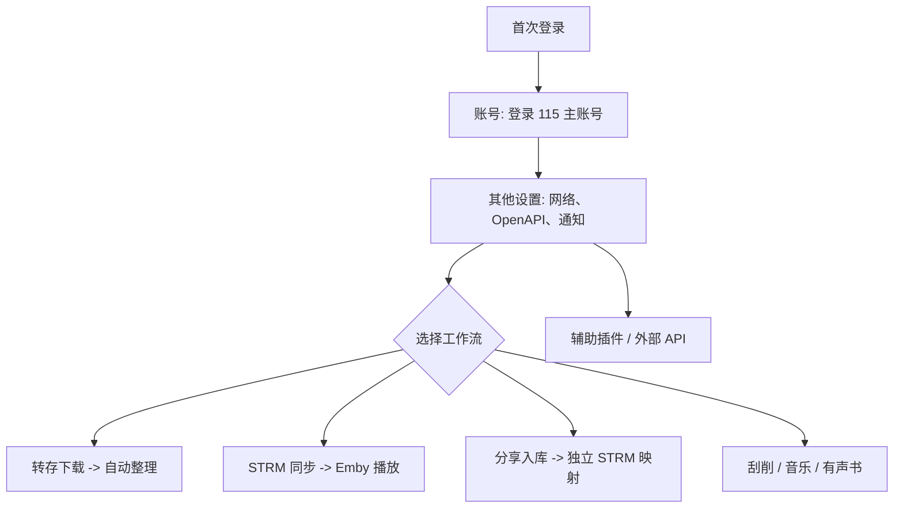

# Flowpan 使用与配置指南

本文面向第一次部署和日常维护。示例使用占位符，**不要把管理员密码、115 Cookie、OpenAPI Token、Telegram Bot Token 或 Emby API Key 提交到 GitHub**。

> 本仓库发布 SDK 与文档。Docker Compose 和完整 Flowpan 服务源码应放在服务源码目录，不能在本 SDK 仓库内直接执行 `docker compose up`。

## 目录

1. [运行结构与端口](#1-运行结构与端口)
2. [Docker 部署](#2-docker-部署)
3. [首次设置与账号](#3-首次设置与账号)
4. [配置保存与备份](#4-配置保存与备份)
5. [Web 设置与使用方法](#5-web-设置与使用方法)
6. [STRM 与 Emby](#6-strm-与-emby)
7. [整理、刮削、通知与插件](#7-整理刮削通知与插件)
8. [外部 API 与 SDK](#8-外部-api-与-sdk)
9. [运维、排障与命令行](#9-运维排障与命令行)

## 1. 运行结构与端口

```mermaid
flowchart LR
  U[浏览器 / Emby / 外部应用] -->|8080| F[Flowpan Web 与 API]
  E[Emby 播放器] -->|8081 本地代理模式| P[Flowpan Emby Proxy]
  F --> C[115 主账号或 OpenAPI]
  F --> D[/config: 设置、Cookie、SQLite]
  F --> L[/logs: 运行日志]
  F --> M[/media: 本地媒体与输出目录]
```

| 端口 | 用途 | 开放建议 |
| --- | --- | --- |
| `8080` | 管理后台、API、STRM 跳转、通知回调 | 仅通过 HTTPS 反向代理或可信局域网开放 |
| `8081` | Emby 本地代理播放 | 只向 Emby 所在网络开放 |

Flowpan 管理员账号保护后台；115 登录决定可以访问的网盘，两者相互独立。

## 2. Docker 部署

### 2.1 前置条件

- 已取得完整 Flowpan 服务源码，源码目录内有 `compose.yaml` 或 `docker-compose.yml`。
- Docker Engine 或 Docker Desktop 已启动。
- 宿主机 `8080`、`8081` 未被占用，且运行目录可创建 `config`、`logs`、`media`。

### 2.2 启动服务

在**服务源码根目录**运行：

```bash
docker compose up -d --build
docker compose ps
docker compose logs -f --tail=200
```

随后访问：

```text
http://<服务器IP>:8080
```

`127.0.0.1` 只代表当前设备；局域网访问应使用服务器的局域网 IP，例如 `http://192.168.1.20:8080`。

### 2.3 Compose 配置模板

可在服务源码根目录使用下列配置。左侧是宿主机路径，应替换为实际目录；右侧容器路径不要改。

```yaml
services:
  flowpan:
    build: .
    image: flowpan:dev
    command: ["serve"]
    environment:
      FLOWPAN_ROOT: /app
      FLOWPAN_HOME: /config
    ports:
      - "8080:8080"
      - "8081:8081"
    volumes:
      - /srv/flowpan/config:/config
      - /srv/flowpan/logs:/logs
      - /srv/flowpan/media:/media
    restart: unless-stopped
```

| 项目 | 说明 |
| --- | --- |
| `FLOWPAN_ROOT=/app` | 程序与 Web 静态资源根目录，Docker 部署保持默认。 |
| `FLOWPAN_HOME=/config` | 配置与数据库根目录，必须持久化挂载。 |
| `/config` | `config.db`、115 登录状态、任务库、更新状态，是最重要的备份目录。 |
| `/logs` | 启动自检、任务和错误日志。 |
| `/media` | 本地媒体、STRM 或有声书目录；实际输出目录以 Web 设置为准。 |

端口冲突时可把左侧改为 `18088:8080`、`18081:8081`；容器内部端口仍分别是 `8080`、`8081`。

### 2.4 本地运行

本地需要 Go 1.25 和可用 C 编译环境以支持 SQLite：

```bash
go run . serve --addr :8080
go run . serve --addr 127.0.0.1:18089 --home ./config-test
```

## 3. 首次设置与账号

### 3.1 创建管理员

首次打开页面会显示管理员设置页。使用独立长密码，公网部署必须通过 HTTPS；账号修改在 **其他设置** 完成，不要直接编辑 SQLite。

### 3.2 登录 115 主账号

进入 **账号** -> **115 主账号** -> **扫码登录**：

1. 选择需要的登录设备类型。
2. 用已登录的 115 客户端扫码并确认。
3. 等页面显示“已登录”后再使用文件管理、转存、整理或 STRM。

主账号承担 STRM、转存、整理和默认文件操作。登录状态在 `/config`，重建容器不会丢失；删除 `/config` 则会丢失。

### 3.3 115 小号池与 OpenAPI

对 Emby 用户使用独立 115 小号时，在 **账号** -> **115 小号池** 登录小号，再到 **辅助插件** -> **115 小号池规则** 绑定 Emby 用户。

OpenAPI 适合减少 Cookie 网页接口依赖，仍应先完成主账号登录。在 **其他设置** 或账号入口填写已授权 AppID，执行授权/初始化；失效后在同一入口重新授权。不要手工编辑 access token 或 refresh token。

## 4. 配置保存与备份

| 类型 | 在哪里配置 | 保存位置 | 用途 |
| --- | --- | --- | --- |
| 容器参数 | Compose 的 `environment`、`ports`、`volumes` | Compose 文件 | 端口、挂载、容器启动 |
| Web 设置 | 页面“保存配置” | `/config/config.db` | 账号、STRM、Emby、通知、插件 |
| 登录状态 | Web 扫码或 CLI 登录 | `/config` 下 Cookie/数据库 | 主号与小号池 |
| 外部程序权限 | **其他设置** -> 外部 API | `/config/config.db` | 其他程序调用 115 能力 |

环境变量通常保持默认：`FLOWPAN_ROOT` 为程序根目录，`FLOWPAN_HOME` 为配置根目录；也可用 `FLOWPAN_LOGS_DIR`、`FLOWPAN_MEDIA_DIR` 覆盖日志和媒体目录。

停止服务后备份整个 `config/`，不要只复制 `config.db`：

```bash
docker compose down
tar -czf flowpan-config-backup-$(date +%F).tar.gz config
```

Windows PowerShell：

```powershell
docker compose down
Copy-Item .\config .\config-backup -Recurse
```

恢复时先停止容器，再覆盖同一 `config/` 挂载目录。

## 5. Web 设置与使用方法



### 5.1 其他设置

| 设置 | 用途 | 建议 |
| --- | --- | --- |
| 管理员账号/密码 | 保护后台 | 公网部署必须使用 HTTPS。 |
| HTTP 代理 | TMDB、Bing、AI、HDHive 等请求可复用 | 填完整 `http://host:port` 或 `https://host:port` 后测试。 |
| OpenAPI | 115 OpenAPI 授权与状态 | 先登录主账号，失效后重新授权。 |
| 外部 API | 给其他程序调用 115 存储接口 | 独立 Token，按最小权限授权。 |
| AI | 整理/识别的可选配置 | 不需要时保持关闭，密钥只填本地后台。 |
| 互动通知 | Telegram、企业微信和任务通知 | 配置后先发送测试通知。 |

外部 API Token 与通知密钥、管理员密码、115 Cookie 不同，不能混用。

### 5.2 文件管理、转存与分享入库

文件管理支持浏览、创建目录、移动、复制、重命名、收藏、删除和查看属性。操作前确认当前账号与路径；删除影响当前选中的云端文件或目录。

**转存下载** 每行可粘贴一个 115 分享、磁力、ED2K 或 HTTP/FTP 链接。设置保存目录、按需开启跳过重复和自动整理；先用少量任务验证账号和目录，再提交批量任务。

**分享入库** 的流程：

1. 粘贴分享链接，必要时填提取码。
2. 选择目标账号、115 分享专用文件夹和本地 STRM 父目录。
3. 点击 **解析预览**，确认目录、媒体数量和过滤结果。
4. 选择需要的一级目录，生成 STRM 和映射。

删除分享入库记录只删除映射、本地 STRM 和字幕，不删除云盘转存文件，也不删除全局分享配置。

## 6. STRM 与 Emby

### 6.1 STRM 配置

在 **STRM 配置** 设置 115 源目录与本地输出目录，选择媒体扩展名、URL 格式、字幕/元数据/图片下载选项。首次应选择小目录完成全量同步，再开启增量同步。输出目录必须挂载或共享给 Emby/Jellyfin。

| 设置 | 说明 |
| --- | --- |
| 本地输出目录 | `.strm`、字幕与可选元数据输出位置。 |
| 115 网盘目录 | 同步源路径，首次建议小范围验证。 |
| URL 格式/编码 | 已有媒体库不要随意切换；含特殊字符时按需开启编码。 |
| 清理源目录变更遗留 | 会影响本地旧 STRM，确认目录无其他文件后再启用。 |
| 事件通知密钥 | 外部 STRM 事件通知使用，单独随机生成并保存。 |

STRM 地址检查插件只检测/修复 Flowpan 生成的播放地址，不修改真实媒体文件。

### 6.2 Emby 代理

在 **Emby 代理** 填写 Emby 地址和 API Key，选择播放模式：`302` 直接跳转，`本地代理` 让播放流经过 Flowpan。默认容器内代理端口是 `8081`，应与 Compose 映射一致。

填写地址/API Key 后可刷新用户，并针对不同 Emby 用户设置播放策略。Webhook 需使用页面生成的回调 URL 和密钥；播放异常时再调整 Lavf 探测兼容开关。

**功能边界：Flowpan 不提供 Emby 删除媒体后自动删除 115 文件的联动功能。**

## 7. 整理、刮削、通知与插件

### 7.1 自动整理、刮削、音乐和有声书

自动整理需要分别设置源目录、电影目录、剧集目录、已存在/失败/冗余目录。目录不能混用；首次改命名规则或启用 TMDB/AI 时，只处理一部电影或一季剧集验证结果，再运行批量任务。

媒体刮削扫描本地影视 STRM，生成 NFO、海报和背景图。设置本地 STRM 根目录、提供者、语言、扫描间隔、并发与重试；需要时使用 HTTP 代理。

音乐中心可设置刮削根目录、扫描周期、并发、标签、歌词、封面和转码参数。有声书设置本地根目录、扫描周期和作者展示，客户端地址为：

```text
http(s)://<主机>:<端口>/audiobookshelf
```

这些本地根目录都必须是 Flowpan 容器可访问的路径。

### 7.2 Telegram、企业微信与辅助插件

| 通道 | 配置项 |
| --- | --- |
| Telegram | 启用、Bot Token、允许用户/群组、通知 Chat ID；按需打开轮询。 |
| 企业微信 | 启用、CorpID、AgentID、Secret、Token、EncodingAESKey、允许来源、接收人和公网回调地址。 |

企业微信回调必须能从公网访问，纯内网地址不能接收回调。填写后先发送测试通知。

辅助插件为 Flowpan 内置功能：115 回收站清理、115 签到、115 文件夹清理、HDHive、Emby 媒体库刷新、STRM 地址检查、115 小号池规则与登录壁纸。回收站/文件夹清理会影响云端文件，应先用最小范围手动验证，再启用定时。

## 8. 外部 API 与 SDK

给其他项目接入时：

1. 在 **其他设置** 启用外部 API。
2. 生成独立 Token。
3. 为调用方按最小权限授予 `read`、`write`、`upload`、`delete`。
4. 使用 `Authorization: Bearer <Token>` 调用。

统一路由：

```text
POST /api/v1/storage/115/{auto|open|cookie}/{action}
```

`auto` 在 OpenAPI 已授权时优先使用 OpenAPI，否则使用 Cookie；`open` 强制 OpenAPI；`cookie` 强制 Cookie。不能用管理员密码、115 Cookie 或 MP 事件密钥代替外部 API Token。

- [外部 115 存储 API 标准](./外部115存储API标准.md)
- [外部 115 存储 SDK](./外部115存储SDK.md)

## 9. 运维、排障与命令行

### 9.1 常用 Docker 命令

```bash
docker compose ps
docker compose logs -f --tail=200
docker compose up -d --build
docker compose down
docker compose exec flowpan sh
```

不要执行 `docker compose down -v`，除非确认不需要卷内数据；它可能删除持久化数据。升级前先备份 `config/`，更新镜像或源码后执行 `docker compose up -d --build`，再检查后台、115 状态、STRM、Emby、插件页面和日志。

### 9.2 常见问题

| 现象 | 检查顺序 |
| --- | --- |
| 打不开后台 | `docker compose ps` -> `docker compose logs -f` -> 端口映射和防火墙。 |
| 重建后设置丢失 | `/config` 是否正确挂载；不要使用容器临时目录存数据。 |
| 115 目录读取失败 | 账号页检查登录；Cookie 失效重新扫码；OpenAPI 失效重新授权。 |
| Emby 无法播放 | Emby 地址/API Key、网络、8081 映射、播放模式、日志。 |
| 刮削无结果 | 本地 STRM 根目录、目录挂载、代理、TMDB/AI 设置和日志。 |
| 外部 API 401/403 | 已启用外部 API、Token 正确、权限涵盖动作、服务地址正确。 |
| 前端仍是旧样式 | 重建并重启实际容器后强制刷新；PWA 可清理站点缓存。 |

### 9.3 命令行

所有命令可用 `--home <配置目录>` 指向独立配置。Docker 生产环境优先使用 Web 页面和容器日志，避免宿主机 `go run` 使用另一套配置。

```bash
go run . devices
go run . login --device alipaymini --browser
go run . login --device alipaymini --open-app-id <APP_ID> --browser
go run . openapi --app-id <APP_ID> --browser
go run . show /
go run . ls /电影 --limit 100
go run . walk /电影 --max-depth 2 --limit 500
go run . ls /电影 --open
```

## 发布检查

- 不提交 `config/`、`*.db`、Cookie、日志、Token、二维码或本地媒体。
- Compose 只使用占位路径或默认相对路径，不写入真实服务器 IP、域名、密码或密钥。
- 更新功能时，同步检查删除、STRM、Emby 与外部 API 的权限说明。
